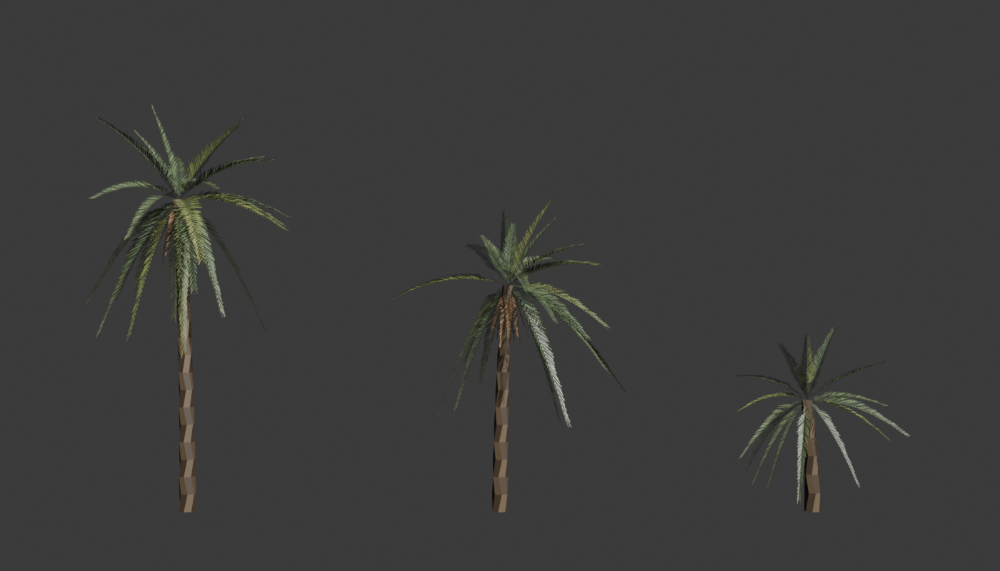

# LowPolyPlants

Low-poly plants, dry grasses and rock clutter for hot, dry towns, made for Heroes of Benghazi: 4 plants, 4 grass
clumps and 3 rock / rubble clumps. Flat slot colours times small tileable textures (leaf, cactus pad, foliage,
stone) with surface variation and defects.

| Mesh | What | Size | Tris (LOD0) |
|---|---|---|---|
| SM_Plant_Agave | blue-grey rosette of thick pointed leaves, dead leaves at the base | ~1.6 m across | 188 |
| SM_Plant_PricklyPear | bunny-ear Opuntia: flat oval pads growing off each other in fans, areoles in the texture | ~1.1 m tall | 1,248 |
| SM_Plant_Oleander | dense dark-green flowering shrub, pink flowers, leafy foliage texture | ~1.8 m | 596 |
| SM_Plant_Saltbush | low grey-green shrub: woody stems and small leaf clusters | ~0.6 m tall | 483 |
| SM_Grass_Tuft | clump of short dry tufts | ~2.5 m across | 252 |
| SM_Grass_Seed | taller tufts with oat-like seed heads | ~2 m across | 234 |
| SM_Grass_Dead | dead brown clumps splayed flat | ~2 m across | 216 |
| SM_Grass_Tussock | bushy pale straw tussocks (roadside grass), 40-70 cm tall | ~1.4 m patch | 900 |
| SM_Rocks_Scatter | loose stones and pebbles | ~1.8 m across | 488 |
| SM_Rocks_Rubble | broken concrete and block chunks with stones | ~1.4 m across | 272 |
| SM_Rocks_Litter | stones with scraps of paper and plastic | ~1.8 m across | 242 |
| SM_Plant_DatePalm_A | date palm (Phoenix dactylifera): curved bark trunk, 28 V-leaflet fronds, dry skirt | ~9 m tall | 1,140 |
| SM_Plant_DatePalm_B | date palm, 26 fronds, dry skirt | ~6.5 m tall | 1,022 |
| SM_Plant_DatePalm_C | young date palm, 16 fronds | ~3.2 m tall | 468 |

Z up, centimetres, pivot on the ground. No collision. Each grass mesh is a clump of several tufts, so a few
instances cover a patch of ground. In the Unreal pack every mesh has 3 LODs (100 / 45 / 15 %).

## Date palms

`SM_Plant_DatePalm_A/B/C` are leaf-card palms, unlike the flat-colour plants above. Each frond is a rib in 6 segments with a
card either side rising 25 deg (a V of leaflets that reads from any angle), textured with `T_PalmFrond.png`: a 2048 px RGBA
atlas of 4 fronds (2 grey-green, 1 yellow-green, 1 dry brown), narrow leaflets angled towards the tip, **alpha = leaf
coverage**. Upper fronds arch up and out, lower ones droop; A and B carry a skirt of dry fronds under the crown.

- Slots: `Trunk` (bark colours in the vertex colours; Kd in the OBJ) and `Frond` (the atlas). Render `Frond` **masked**
  (opacity mask = texture alpha) and **two-sided**. In Unreal: a masked, two-sided material, texture RGB to Base Color,
  A to Opacity Mask; Nanite works with it in 5.8. Add a box around the trunk if you want collision.
- Regenerate: `python gen_datepalm_tex.py` (Pillow) then `blender --background --python gen_datepalm_blender.py`.
  Height, frond count, frond length and droop per variant are in `VARIANTS` at the top of the script.
- Not in the Unreal pack yet (`Unreal/Content/LowPolyPlants`); import the FBXs.

## Unreal (5.8)

Copy `Unreal/Content/LowPolyPlants` into your project's `Content` folder (it must stay at `/Game/LowPolyPlants`).
It is self-contained: meshes, `M_LowPolyPlant`, one material instance per colour slot, the four textures and
`Maps/LowPolyPlants_Showcase`. Saved with UE 5.8, so it opens in 5.8 or later only; for older engines import the FBXs.

`M_LowPolyPlant` (two-sided, default lit):

- `Color` x `Pattern.R` x `PatternGain` - the slot colour with the leaf surface (mottling, fibres, crease, darker edges)
- blended towards `DamageColor` by `Pattern.G` x `DamageAmount` - leaf defects (blemish spots with halos, scratches
  and scars, burnt tips, nibbled edges) in a colour of their own, so they go brown / bleached rather than just darker
- `Wind` - optional sway (world position offset, height-based; zero below 2.5 m, so only tall plants move)

Set `DamageAmount` to 0 for clean leaves or raise it for a harsher, drier look.

Good for scatter: use them in a Hierarchical Instanced Static Mesh or foliage tool. Heroes of Benghazi scatters
~140k grass clumps (no shadows, culled at 100 m), ~7k plants (shadows, culled at 150 m) and ~34k rock clumps
(no shadows, culled at 80 m) over a 2 x 2 km town: a dense tussock band 2.5-9 m off each road, stones and litter
along the roads, rubble along walls.

To rebuild the pack from the generators, see `tools/build_unreal_pack.py` (runs in the editor; replaces the
meshes, textures and material instances in place and adds new meshes to the showcase).

## Other engines / Blender

- `FBX/` - exported from Unreal with LODs, plus the four textures; material slots named as below.
- `OBJ/` - OBJ + MTL with the slot colours as `Kd` (sRGB) and each slot's `*_Surface.png` as the diffuse map
  (surface variation only), LOD0, plus the textures. Opens in Blender, Godot, Unity.

Leaves and blades are single-sided strips: **use a two-sided material** (or disable back-face culling).

### Textures

All 512-1024 px, sRGB, opaque: **R** = surface variation, **G** = defect mask (blends to the slot's damage colour),
B = R. Each has a `_Surface.png` (R alone) for engines that just multiply a diffuse map; the OBJ MTLs use those.
Multiply by the gain to keep the flat colours' brightness.

| Texture | Slots | Gain | G (defects) | Generator |
|---|---|---|---|---|
| T_PlantLeaf | agave, stems, grasses | 1.35 | spots, scratches, burnt tips, nibbled edges | `gen_plant_tex.py` |
| T_CactusPad | Pad | 1.19 | areoles with spines (cream) | `gen_cactus_tex.py` |
| T_Foliage | Leaf, LeafDark, Salt | 1.71 | dead / spotted leaves | `gen_foliage_tex.py` |
| T_Stone | Stone*, Concrete | 1.71 | none | `gen_stone_tex.py` |

Leaf and blade UVs: U across a leaf (0.5 on the midline), V from base to tip, so burnt tips land on the leaf tips.
Foliage clusters and stones have UVs scaled to their surface (one T_Foliage tile per 2 m of oleander canopy,
0.6 m of saltbush; T_Stone every 40 cm). The texture scripts need numpy and Pillow.

| Slot | Linear RGB | Damage amount | Damage colour | Texture |
|---|---|---|---|---|
| Agave | 0.10, 0.16, 0.12 | 0.85 | 0.16, 0.12, 0.07 | T_PlantLeaf |
| AgaveDead | 0.20, 0.13, 0.06 | 0 | | T_PlantLeaf |
| Pad | 0.10, 0.24, 0.05 | 1.0 | 0.62, 0.60, 0.46 | T_CactusPad |
| Fruit | 0.30, 0.03, 0.05 | 0 | | none (unused) |
| Leaf | 0.04, 0.10, 0.03 | 0.9 | 0.26, 0.22, 0.05 | T_Foliage |
| LeafDark | 0.025, 0.07, 0.02 | 0.9 | 0.24, 0.20, 0.05 | T_Foliage |
| Flower | 0.55, 0.12, 0.22 | 0 | | none |
| Stem | 0.12, 0.09, 0.05 | 0 | | T_PlantLeaf |
| Salt | 0.11, 0.15, 0.08 | 0.8 | 0.30, 0.28, 0.18 | T_Foliage |
| Straw | 0.20, 0.16, 0.06 | 0.5 | 0.34, 0.30, 0.18 | T_PlantLeaf |
| StrawPale | 0.30, 0.25, 0.12 | 0.4 | 0.40, 0.36, 0.24 | T_PlantLeaf |
| Olive | 0.11, 0.12, 0.04 | 0.7 | 0.24, 0.20, 0.09 | T_PlantLeaf |
| Seed | 0.26, 0.21, 0.10 | 0 | | T_PlantLeaf |
| DeadGrass | 0.12, 0.07, 0.03 | 0 | | T_PlantLeaf |
| Tussock | 0.30, 0.24, 0.12 | 0.5 | 0.36, 0.32, 0.22 | T_PlantLeaf |
| TussockPale | 0.42, 0.35, 0.20 | 0.4 | 0.46, 0.42, 0.30 | T_PlantLeaf |
| Stone | 0.16, 0.13, 0.10 | 0 | | T_Stone |
| StoneLight | 0.24, 0.20, 0.15 | 0 | | T_Stone |
| StoneDark | 0.09, 0.075, 0.06 | 0 | | T_Stone |
| Concrete | 0.22, 0.21, 0.19 | 0 | | T_Stone |
| Litter | 0.50, 0.49, 0.46 | 0 | | none |
| LitterBlue | 0.08, 0.18, 0.36 | 0 | | none |

## Making more

`gen_plants.py` (Python 3, no dependencies) writes the OBJ/MTL set: `python gen_plants.py [out_dir]`
(add `--unreal` for OBJs flipped for Unreal's importer). Each mesh is a seeded function (`agave`, `prickly_pear`,
`oleander`, `saltbush`, `grass_tuft`, `grass_seed`, `grass_dead`, `grass_tussock`, `rocks_scatter`, `rocks_rubble`,
`rocks_litter`); change the seed or the counts / sizes inside for new variants. `blade()` (leaves, blades, stems),
`blob()` (faceted foliage lumps and stones), `opuntia_pad()`, `tussock()`, `stones()` and `flake()` (litter) are
the building blocks.
