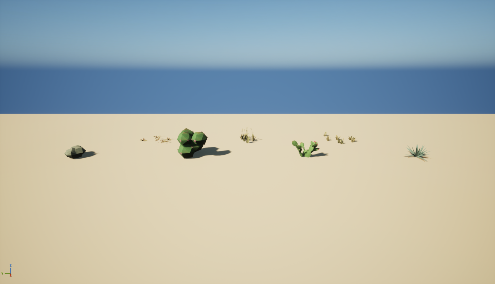
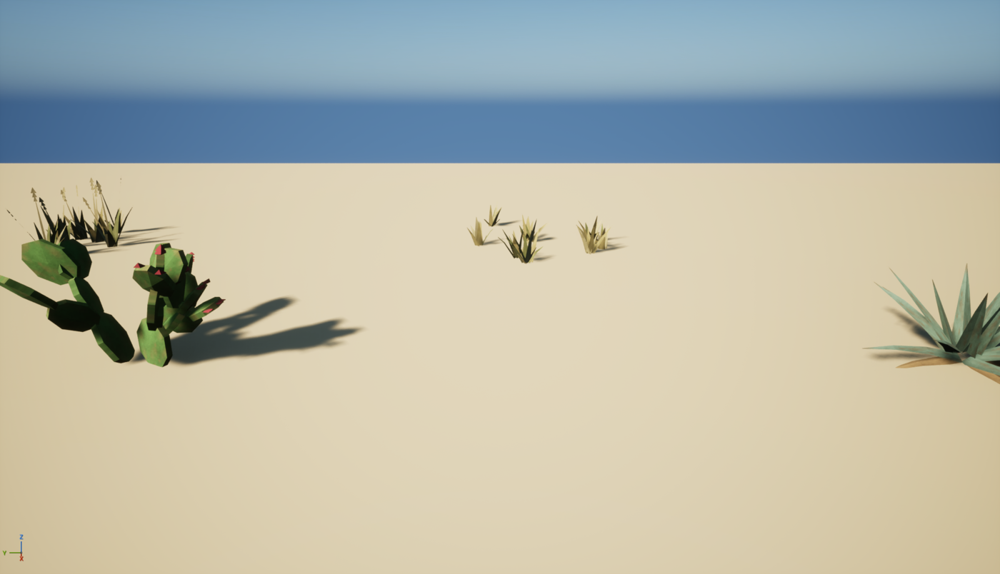

# LowPolyPlants

Low-poly plants and dry grasses for hot, dry towns, made for Heroes of Benghazi: 4 plants and 3 grass clumps,
flat colours plus one shared leaf texture with surface variation and leaf defects.

| Mesh | What | Size | Tris (LOD0) |
|---|---|---|---|
| SM_Plant_Agave | blue-grey rosette of thick pointed leaves, dead leaves at the base | ~1.6 m across | 188 |
| SM_Plant_PricklyPear | Opuntia: flat oval pads growing off each other, red fruit | ~1.3 m tall | 880 |
| SM_Plant_Oleander | dense dark-green flowering shrub, pink flowers | ~1.8 m | 596 |
| SM_Plant_Saltbush | low grey-green mound with dry twigs | ~0.6 m tall | 138 |
| SM_Grass_Tuft | clump of short dry tufts | ~2.5 m across | 252 |
| SM_Grass_Seed | taller tufts with oat-like seed heads | ~2 m across | 234 |
| SM_Grass_Dead | dead brown clumps splayed flat | ~2 m across | 216 |

Z up, centimetres, pivot on the ground. No collision. Each grass mesh is a clump of several tufts, so a few
instances cover a patch of ground. In the Unreal pack every mesh has 3 LODs (100 / 45 / 15 %).

## Unreal (5.8)

Copy `Unreal/Content/LowPolyPlants` into your project's `Content` folder (it must stay at `/Game/LowPolyPlants`).
It is self-contained: meshes, `M_LowPolyPlant`, one material instance per colour slot, `T_PlantLeaf` and
`Maps/LowPolyPlants_Showcase`. Saved with UE 5.8, so it opens in 5.8 or later only; for older engines import the FBXs.

`M_LowPolyPlant` (two-sided, default lit):

- `Color` x `Pattern.R` x `PatternGain` - the slot colour with the leaf surface (mottling, fibres, crease, darker edges)
- blended towards `DamageColor` by `Pattern.G` x `DamageAmount` - leaf defects (blemish spots with halos, scratches
  and scars, burnt tips, nibbled edges) in a colour of their own, so they go brown / bleached rather than just darker
- `Wind` - optional sway (world position offset, height-based; zero below 2.5 m, so only tall plants move)

Set `DamageAmount` to 0 for clean leaves or raise it for a harsher, drier look.

Good for scatter: use them in a Hierarchical Instanced Static Mesh or foliage tool. Heroes of Benghazi scatters
~100k grass clumps (no shadows, culled at 100 m) and ~7k plants (shadows, culled at 150 m) over a 2 x 2 km town.

## Other engines / Blender

- `FBX/` - exported from Unreal with LODs; material slots named as below.
- `OBJ/` - OBJ + MTL with the slot colours as `Kd` (sRGB) and `T_PlantLeaf_Surface.png` as the diffuse map
  (surface variation only), LOD0. Opens in Blender, Godot, Unity.

Leaves and blades are single-sided strips: **use a two-sided material** (or disable back-face culling).

### Leaf texture

`T_PlantLeaf.png` (512 x 512, sRGB, opaque): **R** = surface variation, **G** = defect mask, B = R.
`T_PlantLeaf_Surface.png` is R alone, for engines that just multiply a diffuse map. Average surface brightness is
about 0.73 (linear): multiply by about 1.37 to keep the flat colours' look. UVs: U across a leaf / blade
(0.5 on the midline), V from base to tip, so burnt tips land on the leaf tips. `gen_plant_tex.py` regenerates
both (needs numpy and Pillow).

| Slot | Linear RGB | Damage amount | Damage colour |
|---|---|---|---|
| Agave | 0.10, 0.16, 0.12 | 0.85 | 0.16, 0.12, 0.07 |
| AgaveDead | 0.20, 0.13, 0.06 | 0 | |
| Pad | 0.07, 0.15, 0.04 | 0.7 | 0.22, 0.18, 0.07 |
| Fruit | 0.30, 0.03, 0.05 | 0 (untextured) | |
| Leaf | 0.04, 0.10, 0.03 | 0.6 | 0.12, 0.07, 0.02 |
| LeafDark | 0.025, 0.07, 0.02 | 0.6 | 0.10, 0.06, 0.02 |
| Flower | 0.55, 0.12, 0.22 | 0 (untextured) | |
| Stem | 0.12, 0.09, 0.05 | 0 | |
| Salt | 0.13, 0.15, 0.10 | 0.5 | 0.20, 0.18, 0.12 |
| Straw | 0.20, 0.16, 0.06 | 0.5 | 0.34, 0.30, 0.18 |
| StrawPale | 0.30, 0.25, 0.12 | 0.4 | 0.40, 0.36, 0.24 |
| Olive | 0.11, 0.12, 0.04 | 0.7 | 0.24, 0.20, 0.09 |
| Seed | 0.26, 0.21, 0.10 | 0 | |
| DeadGrass | 0.12, 0.07, 0.03 | 0 | |

## Making more

`gen_plants.py` (Python 3, no dependencies) writes the OBJ/MTL set: `python gen_plants.py [out_dir]`. Each plant
is a seeded function (`agave`, `prickly_pear`, `oleander`, `saltbush`, `grass_tuft`, `grass_seed`, `grass_dead`);
change the seed or the counts / sizes inside for new variants. `blade()` (leaves, blades, stems), `blob()` (faceted
foliage lumps) and `opuntia_pad()` are the building blocks.
